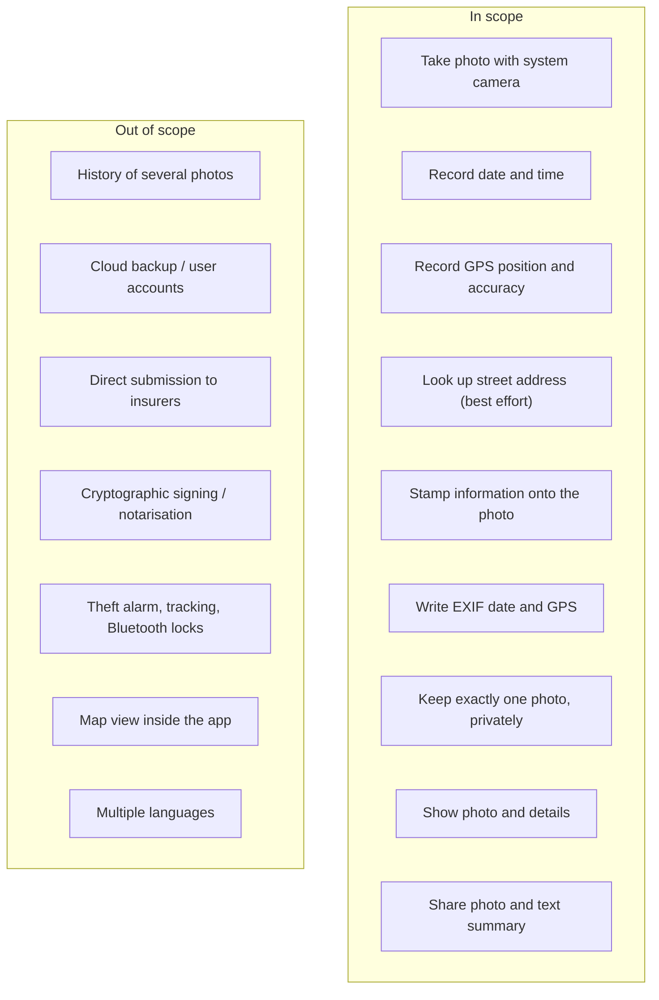

# 01 – Vision and Scope

[← Index](README.md) · [Next: Stakeholders and Personas →](02-stakeholders-and-personas.md)

## 1.1 Problem statement

Bicycle insurance policies often pay out after a theft only if the owner can
show that the bike was **locked** at the time, and **where** and **when** it
was left. In practice, owners rarely have proof: photos in the gallery have
no visible date or place, get lost among hundreds of other pictures, and
nobody wants every parking spot cluttering their photo library.

## 1.2 Vision

> One tap after locking the bike creates a single, private, tamper-evident
> photo that shows the lock, the date, the time and the place – ready to send
> to the insurer or the police.

## 1.3 Goals

| ID | Goal | Measured by |
| --- | --- | --- |
| G-1 | Documenting a lock takes **under 15 seconds** from opening the app | stopwatch test (TC-40) |
| G-2 | The evidence is **self-contained**: date, time and location are readable on the image itself | visual inspection of shared file |
| G-3 | The user's photo library stays **clean**: nothing is written to the gallery | TC-30 |
| G-4 | There is **never any doubt which photo is current**: exactly one photo exists | TC-20, TC-21 |
| G-5 | The evidence can be **sent anywhere** using the phone's normal sharing | TC-50 |

## 1.4 Scope (release 1.0)

## 1.5 Out of scope – reasons

| Item | Reason |
| --- | --- |
| Photo history | Contradicts G-4; one current photo is the product's core idea. |
| Cloud / accounts | Privacy promise (NFR-01); no backend to operate. |
| Insurer integration | Every insurer differs; sharing covers e-mail and web upload. |
| Cryptographic proof | Legal value unclear; considered for a later release (see [15](15-risks-and-open-issues.md)). |
| Map view | Google Maps link in the shared text is sufficient. |
| Localisation | Single user group in 1.0; texts are kept in one place for later translation. |

## 1.6 Success criteria for release 1.0

1. All **Must** requirements in [03](03-functional-requirements.md) and
   [04](04-non-functional-requirements.md) are implemented and pass their
   test cases in [12](12-test-plan.md).
2. `flutter analyze` reports no issues; all automated tests pass.
3. The release APK installs and works on at least one Android 10+ and one
   Android 14+ device.
4. A shared photo, opened on a different device, shows date, time and
   location without any app.

## 1.7 Constraints

- **C-1** Cross-platform with a single code base: Flutter / Dart.
- **C-2** No server, no backend, no paid services.
- **C-3** Only well-maintained packages from pub.dev (Flutter Favorite or
  > 1000 likes preferred).
- **C-4** Distribution outside the app stores must be possible (APK).
- **C-5** Team size: one developer; total effort budget about 5 person-days.
