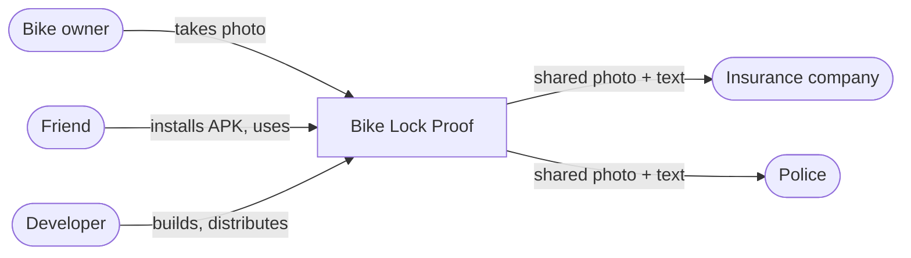
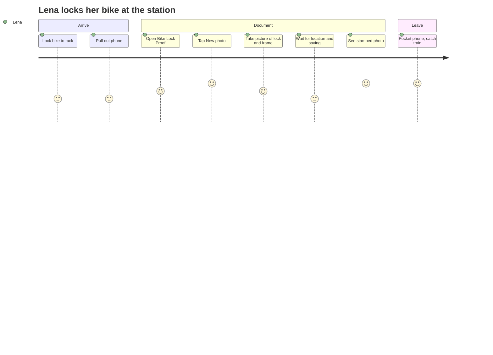
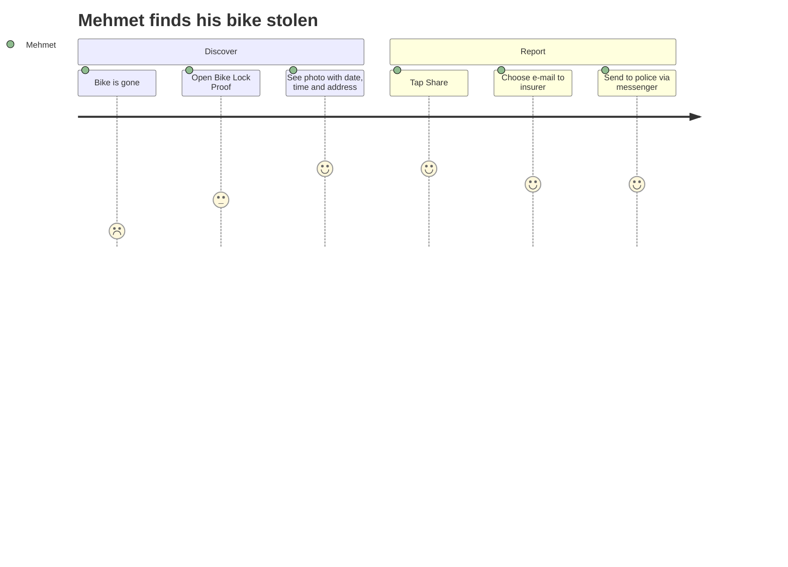

# 02 – Stakeholders and Personas

[← Vision and Scope](01-vision-and-scope.md) · [Index](README.md) · [Next: Functional Requirements →](03-functional-requirements.md)

## 2.1 Stakeholders

| Stakeholder | Interest | Influence |
| --- | --- | --- |
| **Bike owner** (primary user) | Fast, reliable proof; privacy | high |
| **Friends of the owner** (secondary users) | Same app, easy install without a store | medium |
| **Insurance company** (recipient) | Readable date, time, place; image not obviously edited | indirect |
| **Police** (recipient) | Location and time of theft for the report | indirect |
| **Developer / maintainer** | Small, understandable code base; easy builds | high |

## 2.2 Personas

### Persona A – Lena, daily commuter

- 34, rides an e-bike worth 3,500 € to the train station every day.
- Has a bike insurance policy that requires the bike to be locked to a fixed
  object.
- Phone: mid-range Android, often low battery, sometimes poor reception in the
  bike garage.
- **Needs**: one tap, no fiddling; must work in a hurry before the train
  leaves; doesn't want 250 bike photos per year in her gallery.
- **Quote**: *"I lock my bike, take a photo, and run."*

### Persona B – Jonas, weekend city tourer

- 27, parks in different, unfamiliar places in other cities.
- iPhone user.
- **Needs**: find out later *where* exactly he parked; send the location to a
  friend who picks up the bike.
- **Quote**: *"Where did I leave it again?"*

### Persona C – Mehmet, theft victim

- Comes back and the bike is gone.
- **Needs**: send evidence to the police and the insurer *immediately*,
  from the street, without explaining anything.
- **Quote**: *"I need proof that it was locked, now."*

## 2.3 User journey – daily lock (Lena)

## 2.4 User journey – theft (Mehmet)

## 2.5 Key insights from the personas

| Insight | Consequence in the spec |
| --- | --- |
| Users are in a hurry | Location lookup runs in parallel with the camera (FR-03, NFR-10). |
| Bad reception in garages | Address lookup is optional; coordinates are enough (FR-04, FR-13). |
| Gallery clutter is a real annoyance | Private storage only (FR-07, NFR-01). |
| Victims are stressed | Share is one tap, text is pre-filled (FR-12). |
| Insurer may doubt the photo | Information is burned into the image *and* stored as EXIF (FR-05, FR-06). |
