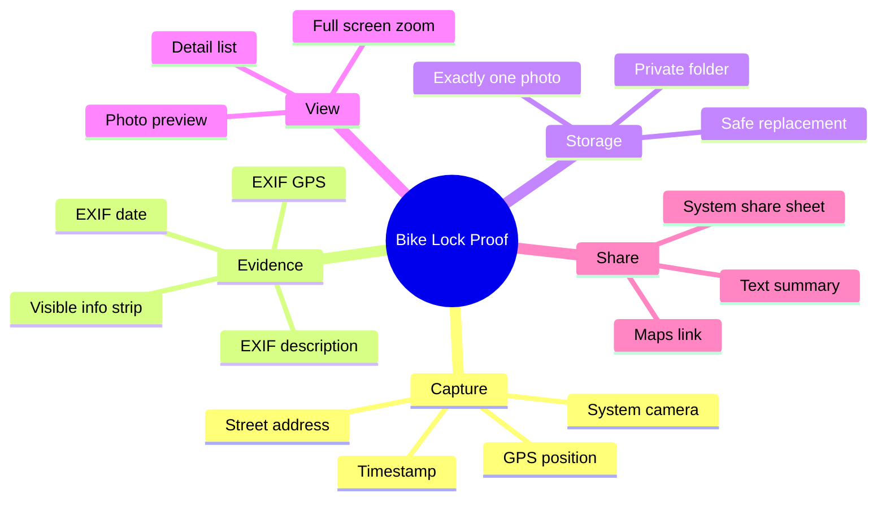
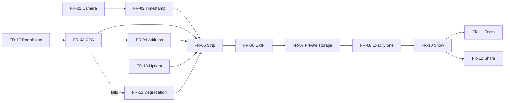

# 03 – Functional Requirements

[← Stakeholders and Personas](02-stakeholders-and-personas.md) · [Index](README.md) · [Next: Non-Functional Requirements →](04-non-functional-requirements.md)

## 3.1 User stories

| ID | As a … | I want to … | so that … | Prio |
| --- | --- | --- | --- | --- |
| US-1 | bike owner | take a photo of my locked bike with one tap | I have proof it was locked | M |
| US-2 | bike owner | have date and time recorded automatically | I can prove *when* it was locked | M |
| US-3 | bike owner | have the location recorded automatically | I can prove and remember *where* it was locked | M |
| US-4 | bike owner | see the information on the photo itself | the recipient doesn't need special software | M |
| US-5 | bike owner | only ever keep the latest photo | I never send an outdated photo by mistake | M |
| US-6 | bike owner | keep the photos out of my gallery | my photo library stays clean and private | M |
| US-7 | theft victim | share the photo with one tap | I can send it to police and insurer immediately | M |
| US-8 | bike owner | see the address, not just coordinates | I understand the place at a glance | S |
| US-9 | bike owner | zoom into the photo | I can check the lock is clearly visible | S |
| US-10 | bike owner | still save the photo when GPS fails | I have at least the time-stamped proof | M |

## 3.2 Feature overview



## 3.3 Requirements

### Capture

| ID | Requirement | Prio | Story |
| --- | --- | --- | --- |
| **FR-01** | The app must open the device's **system camera** (rear camera preferred) when the user taps *Take photo* / *New photo*. | M | US-1 |
| **FR-02** | The app must record the **local date and time** at the moment the camera returns a photo, with second precision. | M | US-2 |
| **FR-03** | The app must determine the **GPS position** (latitude, longitude, accuracy in metres) with the best available accuracy. The lookup must **start before the camera opens** and run in parallel. It must give up after **30 seconds** and then use the last known position, if any. | M | US-3 |
| **FR-04** | The app should convert the position into a short **street address** (`street, postcode city`) using the platform geocoder, with a **timeout of 8 seconds**. Failure must not block saving. | S | US-8 |
| **FR-17** | The location permission must be requested **just in time** (first photo), not at app start. Only *while in use* permission is requested. | M | US-3 |

### Evidence

| ID | Requirement | Prio | Story |
| --- | --- | --- | --- |
| **FR-05** | The saved photo must contain a **visible information strip** along the bottom edge with: date and time (`dd.MM.yyyy HH:mm:ss`), address (if known), and `GPS <lat>, <lon>  (±<accuracy> m)` or `Location unavailable`. The strip must be readable on a phone screen without zooming. | M | US-4 |
| **FR-06** | The saved JPEG must contain **EXIF** tags: `DateTime`, `DateTimeOriginal`, `ImageDescription` (the strip text) and GPS latitude/longitude with hemisphere references (if known). | M | US-2, US-3 |
| **FR-18** | The photo must be stored **upright** regardless of how the phone was held. | M | US-4 |

### Storage

| ID | Requirement | Prio | Story |
| --- | --- | --- | --- |
| **FR-07** | Photos and metadata must be stored **only in the app's private storage**. Nothing may be written to the gallery / Photos library / shared media storage. | M | US-6 |
| **FR-08** | After a successful save, **exactly one** photo must exist. The previous photo must be deleted **only after** the new one and its metadata have been written completely. | M | US-5 |
| **FR-09** | If the user **cancels** the camera, the existing photo and metadata must stay unchanged. | M | US-5 |
| **FR-15** | Temporary files created by the camera must be **deleted** after processing, whether saving succeeded or not. | M | US-6 |

### View

| ID | Requirement | Prio | Story |
| --- | --- | --- | --- |
| **FR-10** | On start, the app must **load and show** the stored photo with date/time, address (if any), and coordinates with accuracy. | M | US-7 |
| **FR-11** | Tapping the photo should open a **full-screen view** with pinch-to-zoom (up to 6×). | S | US-9 |
| **FR-16** | Without a stored photo the app must show an **empty state** that explains what the app does. | M | – |
| **FR-14** | While processing, the app must show a **progress indicator** with the current step (*Getting location…*, *Saving photo…*) and disable the buttons. | M | US-1 |

### Share

| ID | Requirement | Prio | Story |
| --- | --- | --- | --- |
| **FR-12** | A *Share* button must open the **system share sheet** with the JPEG file and a text containing: date/time, address (if any), coordinates with accuracy, and a Google Maps link (if location known). The subject must be `Bike lock <date time>`. *Share* is disabled while there is no photo. | M | US-7 |

### Degradation

| ID | Requirement | Prio | Story |
| --- | --- | --- | --- |
| **FR-13** | If no location can be determined (service off, permission denied, no fix), the photo must **still be saved** with `Location unavailable`, and the user must be informed with a short message. | M | US-10 |

## 3.4 Acceptance criteria (Gherkin)

```gherkin
Feature: Document a locked bike

  Scenario: Take the first photo with location
    Given no photo is stored
    And location permission is granted and GPS has a fix
    When I tap "Take photo" and take a picture
    Then the app shows the photo
    And the photo shows today's date and time in the bottom strip
    And the photo shows "GPS" followed by my coordinates
    And the details list shows the same date, time and coordinates

  Scenario: Replace the photo
    Given a photo is stored
    When I tap "New photo" and take a picture
    Then exactly one photo file exists in app storage
    And it is the new photo

  Scenario: Cancel the camera
    Given a photo is stored
    When I tap "New photo" and cancel the camera
    Then the stored photo and its details are unchanged

  Scenario: No location
    Given location services are turned off
    When I take a photo
    Then the photo is saved
    And the strip says "Location unavailable"
    And a message tells me the location could not be determined

  Scenario: Share
    Given a photo is stored
    When I tap "Share"
    Then the system share sheet opens with the photo attached
    And the text contains the date, time and a maps link

  Scenario: Gallery stays clean
    When I take a photo
    Then no new image appears in the device gallery
```

## 3.5 Requirement dependencies


