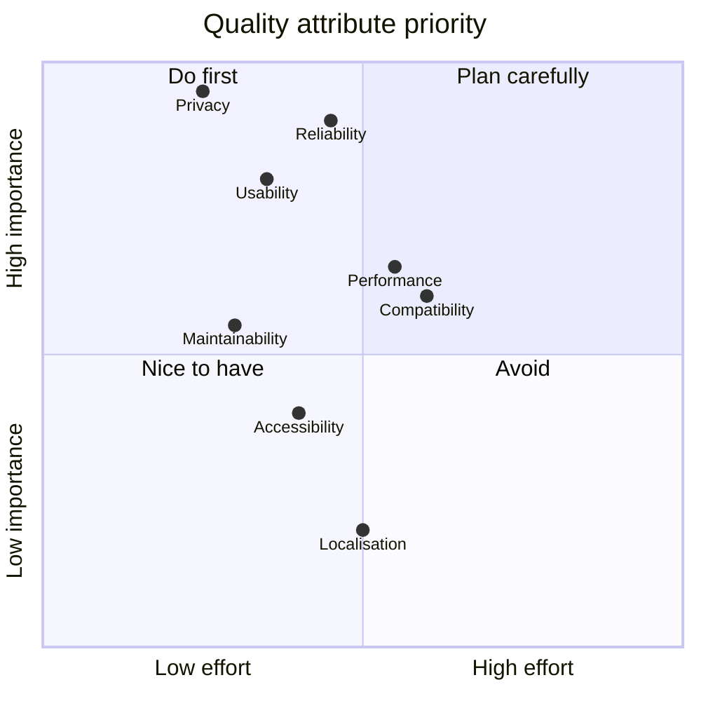

# 04 – Non-Functional Requirements

[← Functional Requirements](03-functional-requirements.md) · [Index](README.md) · [Next: Use Cases →](05-use-cases.md)

Quality attributes follow ISO/IEC 25010.

## 4.1 Privacy (Security – confidentiality)

| ID | Requirement | Prio | Verification |
| --- | --- | --- | --- |
| **NFR-01** | No photo or location may leave the device **except** when the user explicitly shares it, and coordinates sent to the OS geocoder (FR-04). | M | code review, TC-31 |
| **NFR-02** | The app must contain **no analytics, tracking, advertising or crash-reporting SDKs**. | M | dependency review |
| **NFR-03** | Location must only be accessed **while the app is in use**; no background location. | M | manifest review, TC-32 |
| **NFR-04** | Uninstalling the app must remove all its data. | M | TC-33 |

## 4.2 Reliability

| ID | Requirement | Prio | Verification |
| --- | --- | --- | --- |
| **NFR-05** | A crash or power loss at any point during saving must never leave the app **without any photo** if one existed before. | M | design review (see [08](08-data-model-and-storage.md#84-replacement-algorithm)), TC-22 |
| **NFR-06** | Corrupt or missing metadata must not crash the app; it must show the empty state instead. | M | TC-23 |
| **NFR-07** | No unhandled exceptions in any flow listed in [11](11-error-handling.md). | M | TC-60…TC-66 |

## 4.3 Performance

| ID | Requirement | Prio | Verification |
| --- | --- | --- | --- |
| **NFR-10** | After the camera returns, processing (stamping + saving, excluding waiting for GPS) must take **≤ 3 s** on a mid-range device (e.g. 2022 Android with 6 GB RAM). | S | TC-41 |
| **NFR-11** | The UI must stay responsive (no frame drops > 100 ms) while encoding; CPU-heavy work must run **off the UI isolate**. | S | DevTools profiling |
| **NFR-12** | App start to photo visible: **≤ 1.5 s** (warm start). | S | TC-42 |
| **NFR-13** | Saved photos must be **≤ 2560 px** on the long side and typically **≤ 2 MB**, to be sendable via messengers and e-mail. | M | TC-43 |

## 4.4 Usability

| ID | Requirement | Prio | Verification |
| --- | --- | --- | --- |
| **NFR-20** | The main task needs **at most 2 taps** in the app plus the camera shutter. | M | TC-40 |
| **NFR-21** | Primary actions are at the **bottom** of the screen, reachable one-handed. | S | UX review |
| **NFR-22** | The app must support **light and dark mode** following the system setting. | S | TC-44 |
| **NFR-23** | Every error must be shown as a **short, plain-language message**; no stack traces. | M | TC-60…TC-66 |

## 4.5 Accessibility

| ID | Requirement | Prio | Verification |
| --- | --- | --- | --- |
| **NFR-25** | Buttons have text labels (not icon-only), so screen readers announce them. | S | TalkBack / VoiceOver check |
| **NFR-26** | Text respects the system font size. | S | TC-45 |
| **NFR-27** | Touch targets ≥ 48 × 48 dp. | S | Material defaults |

## 4.6 Compatibility

| ID | Requirement | Prio | Verification |
| --- | --- | --- | --- |
| **NFR-30** | Android: the minimum SDK of the current stable Flutter release, target SDK = latest. | M | build config |
| **NFR-31** | iOS: minimum version of the current stable Flutter release. | S | build config |
| **NFR-32** | Phones in portrait orientation; tablets supported without special layout. Share popover anchored correctly on iPad. | S | TC-51 |
| **NFR-33** | Shared JPEG must open correctly in common viewers (Android gallery of the *recipient*, iOS Photos, Windows Photos, web browsers) with correct orientation. | M | TC-52 |

## 4.7 Maintainability

| ID | Requirement | Prio | Verification |
| --- | --- | --- | --- |
| **NFR-40** | `flutter analyze` with the default `flutter_lints` rules reports **zero** issues. | M | CI / local |
| **NFR-41** | Code formatted with `dart format`. | M | CI / local |
| **NFR-42** | Business logic (model, storage, formatting) is **separate from widgets** and unit-tested. | M | review, TC-01…TC-05 |
| **NFR-43** | Every public class and method has a doc comment. | S | review |
| **NFR-44** | README describes setup, build, debug and distribution. | M | review |
| **NFR-45** | At most **7 third-party runtime packages**. | S | `pubspec.yaml` |

## 4.8 Portability and distribution

| ID | Requirement | Prio | Verification |
| --- | --- | --- | --- |
| **NFR-50** | A release APK must be buildable with a **single command** on Linux, macOS or Windows. | M | TC-70 |
| **NFR-51** | Release signing key must be configurable **without committing secrets**. | M | review |
| **NFR-52** | Updates installed over an older version must **keep the stored photo**. | M | TC-71 |

## 4.9 Localisation

| ID | Requirement | Prio | Verification |
| --- | --- | --- | --- |
| **NFR-60** | Date format `dd.MM.yyyy HH:mm:ss` (24 h) in all languages, defined per language as a translatable pattern. | M | TC-02 |
| **NFR-61** | All user-visible texts – UI, messages, stamped strip, shared text – come from ARB files (`flutter gen-l10n`). Supported: English (fallback), German. The language follows the system setting. | M | TC-46, review |
| **NFR-62** | Adding a language requires only a new ARB file (plus launcher name / iOS locale list), no code changes. | S | review |
| **NFR-63** | The street address is requested in the app's language. | C | TC-46 |
