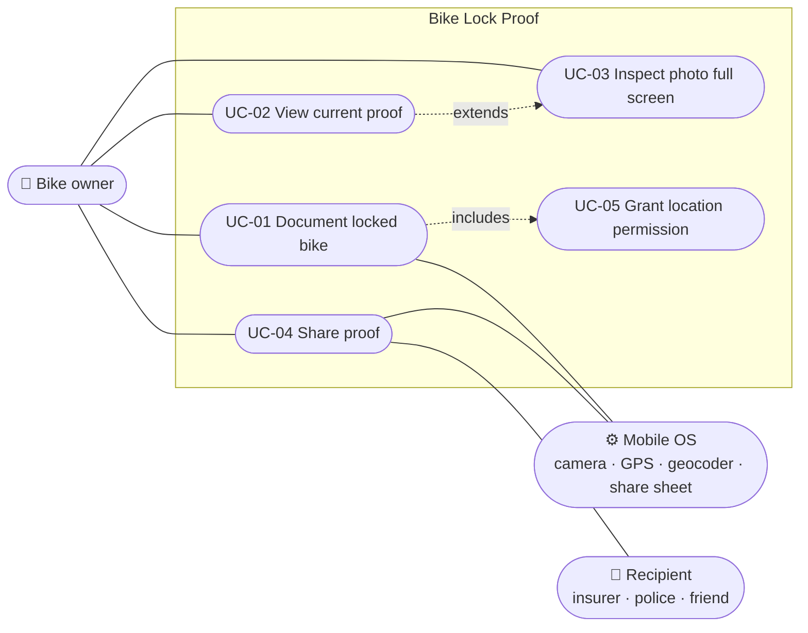

# 05 – Use Cases

[← Non-Functional Requirements](04-non-functional-requirements.md) · [Index](README.md) · [Next: UI and UX Specification →](06-ui-ux-specification.md)

## 5.1 Use case overview

---

## UC-01 Document locked bike

| | |
| --- | --- |
| **Actor** | Bike owner |
| **Goal** | Store a stamped photo of the locked bike, replacing the previous one |
| **Trigger** | User taps *Take photo* (no photo yet) or *New photo* |
| **Preconditions** | App is open; no processing in progress |
| **Postconditions (success)** | Exactly one stamped photo with metadata is stored and shown |
| **Postconditions (cancel / failure)** | Previous photo and metadata unchanged |
| **Requirements** | FR-01…FR-09, FR-13…FR-15, FR-17, FR-18 |

**Main flow**

1. User taps *New photo*.
2. App starts determining the location in the background (→ UC-05 if
   permission is not yet granted).
3. App opens the system camera.
4. User takes a photo and confirms it.
5. App records the current date and time.
6. App shows *Getting location…* and waits for the location result.
7. App looks up the street address.
8. App shows *Saving photo…*, stamps the photo, writes EXIF data and stores
   it.
9. App deletes the previous photo and the camera's temporary file.
10. App shows the new photo and its details.

**Alternative flows**

| ID | At step | Condition | Behaviour |
| --- | --- | --- | --- |
| 1a | 3 | Camera can't be opened | Message *Could not open camera*; end, nothing changed. |
| 4a | 4 | User cancels the camera | End, nothing changed (FR-09). |
| 6a | 6 | Location services off | Message *Location services are turned off*; continue at 8 without location. |
| 6b | 6 | Permission denied | Message *Location permission denied*; continue at 8 without location. |
| 6c | 6 | No fix within 30 s | Use last known position; if none, continue without location. |
| 7a | 7 | Offline / geocoder fails / > 8 s | Continue without address. |
| 8a | 8 | Stamping or writing fails | Message *Saving failed*; previous photo kept; temp file deleted. |
| 10a | 10 | Saved without location | Additional message *Photo saved, but the location could not be determined.* |

---

## UC-02 View current proof

| | |
| --- | --- |
| **Actor** | Bike owner |
| **Trigger** | App start |
| **Postcondition** | Photo and details visible, or empty state |
| **Requirements** | FR-10, FR-16, NFR-06 |

**Main flow**

1. App starts and shows a loading indicator.
2. App reads the metadata file.
3. App checks that the referenced photo exists.
4. App shows photo, date/time, address and coordinates.

**Alternative flows**

| ID | At step | Condition | Behaviour |
| --- | --- | --- | --- |
| 2a | 2 | No metadata file | Show empty state. |
| 2b | 2 | Metadata unreadable | Show empty state (NFR-06). |
| 3a | 3 | Photo file missing | Show empty state. |

---

## UC-03 Inspect photo full screen

| | |
| --- | --- |
| **Actor** | Bike owner |
| **Trigger** | Tap on the photo |
| **Requirements** | FR-11 |

1. User taps the photo.
2. App opens a black full-screen page with the photo.
3. User pinches to zoom (up to 6×) and pans.
4. User taps *Back* to return.

---

## UC-04 Share proof

| | |
| --- | --- |
| **Actor** | Bike owner; Recipient |
| **Trigger** | User taps *Share* |
| **Preconditions** | A photo is stored |
| **Requirements** | FR-12, NFR-01 |

1. User taps *Share*.
2. App opens the system share sheet with the photo, the text summary and
   the subject.
3. User picks a target (e-mail, messenger, …) and sends.

**Alternative flows**: 3a – user dismisses the sheet: nothing happens.

---

## UC-05 Grant location permission

| | |
| --- | --- |
| **Actor** | Bike owner; OS |
| **Trigger** | First photo (permission state *denied*, not *forever*) |
| **Requirements** | FR-17, NFR-03 |

1. App asks the OS for *while in use* location permission.
2. OS shows its permission dialog.
3. User allows.
4. Location lookup continues (UC-01 step 2).

**Alternative flows**: 3a – user denies → UC-01 6b. Permission
*denied forever* → no dialog, UC-01 6b directly.
