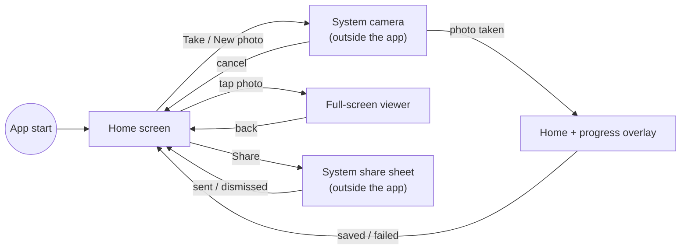
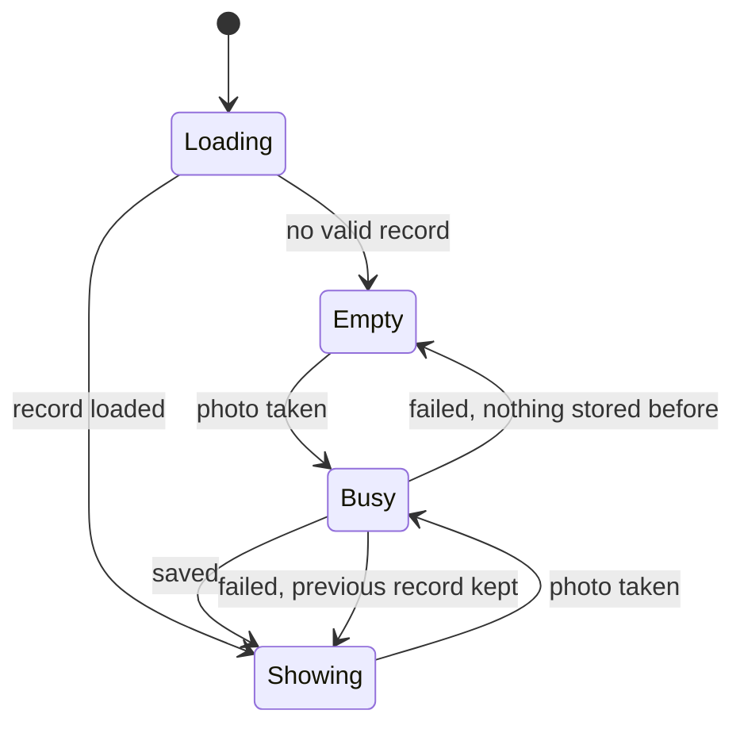

# 06 – UI and UX Specification

[← Use Cases](05-use-cases.md) · [Index](README.md) · [Next: System Architecture →](07-system-architecture.md)

## 6.1 Design principles

1. **One screen.** Everything the user needs is on the home screen.
2. **Thumb-friendly.** Primary actions sit in a fixed bar at the bottom.
3. **The photo is the hero.** It takes the full width; details follow below.
4. **Platform-native.** Material 3, system camera, system share sheet –
   nothing the user has to learn.
5. **Calm under stress.** No dialogs to confirm, no settings, short messages.

## 6.2 Navigation



## 6.3 Screen states



| State | Content | *Take/New photo* | *Share* |
| --- | --- | --- | --- |
| Loading | Centered spinner | enabled | disabled |
| Empty | Bike icon, *No photo yet*, explanation | enabled, label *Take photo* | disabled |
| Showing | Photo, details card | enabled, label *New photo* | enabled |
| Busy | Previous content dimmed + card with spinner and step text | disabled | disabled |

## 6.4 Wireframes

### Home – empty state

```
┌──────────────────────────────┐
│ Bike Lock Proof              │  ← AppBar
├──────────────────────────────┤
│                              │
│            🚲                │  ← Icons.pedal_bike, 96 dp, primary colour
│                              │
│        No photo yet          │  ← titleLarge
│                              │
│  Take a photo of your locked │
│  bike. Date, time and loca-  │  ← body, centred
│  tion are saved with it.     │
│  Each new photo replaces the │
│  previous one.               │
│                              │
├──────────────────────────────┤
│ [📷 Take photo] [⇪ Share]    │  ← Filled + Outlined (disabled)
└──────────────────────────────┘
```

### Home – showing a record

```
┌──────────────────────────────┐
│ Bike Lock Proof              │
├──────────────────────────────┤
│ ┌──────────────────────────┐ │
│ │                          │ │
│ │      (bike photo)        │ │  ← rounded 12 dp, tap → full screen
│ │                          │ │
│ │▓10.10.2026  18:30:05    ▓│ │
│ │▓Main St 1, 10115 Berlin ▓│ │  ← stamped strip (part of image)
│ │▓GPS 52.52, 13.40 (±4 m) ▓│ │
│ └──────────────────────────┘ │
│ ┌──────────────────────────┐ │
│ │ 🕑 10.10.2026 18:30:05   │ │
│ │    Date & time           │ │
│ │ 📍 Main St 1, 10115 Berlin│ │  ← only if address known
│ │    Address               │ │
│ │ ⌖ 52.520008, 13.404954   │ │
│ │    GPS (±4 m)            │ │
│ └──────────────────────────┘ │
├──────────────────────────────┤
│ [📷 New photo]  [⇪ Share]    │
└──────────────────────────────┘
```

### Busy overlay

```
┌──────────────────────────────┐
│░░░░░░░░░░░░░░░░░░░░░░░░░░░░░░│
│░░░░░┌──────────────────┐░░░░░│
│░░░░░│        ◌         │░░░░░│
│░░░░░│ Getting location…│░░░░░│  ← or "Saving photo…"
│░░░░░└──────────────────┘░░░░░│
│░░░░░░░░░░░░░░░░░░░░░░░░░░░░░░│
├──────────────────────────────┤
│ [📷 New photo]  [⇪ Share]    │  ← both disabled
└──────────────────────────────┘
```

### Full-screen viewer

```
┌──────────────────────────────┐
│ ←                            │  ← black AppBar, white back arrow
│                              │
│      (photo, pinch-zoom      │  ← InteractiveViewer, max 6×
│       and pan, black bg)     │
│                              │
└──────────────────────────────┘
```

## 6.5 Stamped information strip (on the image)

| Property | Value |
| --- | --- |
| Position | Full width, bottom edge of the image |
| Background | Black, 55 % opacity |
| Text colour | White, weight 600, line height 1.3 |
| Font size | 3.5 % of the image's **short** side (≈ 50 px on a 1440 px wide photo) |
| Padding | 0.6 × font size on all sides |
| Line 1 | `dd.MM.yyyy  HH:mm:ss` (two spaces) |
| Line 2 | Address – omitted if unknown |
| Line 3 | `GPS <lat 6 dp>, <lon 6 dp>  (±<m> m)` or `Location unavailable` |
| Wrapping | Long addresses wrap within the image width |

## 6.6 Messages (snack bars)

| Situation | Text |
| --- | --- |
| Camera cannot be opened | `Could not open camera: <error>` |
| Location services off | `Location services are turned off.` |
| Permission denied | `Location permission denied.` |
| Saved without location | `Photo saved, but the location could not be determined.` |
| Saving failed | `Saving failed: <error>` |

## 6.7 Share content

```
Subject: Bike lock 10.10.2026 18:30:05

Bike locked on 10.10.2026 18:30:05
Main St 1, 10115 Berlin
GPS: 52.520008, 13.404954 (±4 m)
https://maps.google.com/?q=52.520008,13.404954
```

Lines for address, accuracy and the maps link are omitted when unknown;
without location the GPS line reads `GPS: Unknown location`.

## 6.8 Visual design

- Material 3, colour scheme generated from seed **teal**.
- Light and dark theme follow the system (NFR-22).
- App name on the home screen / launcher: **Bike Lock Proof**.
- Page padding 16 dp; gap between buttons 12 dp.
