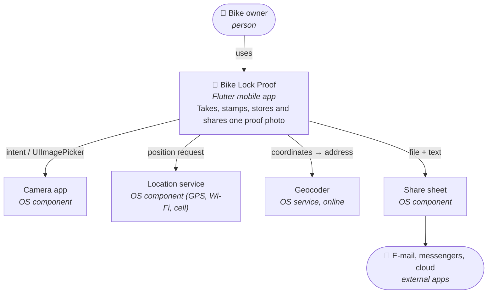
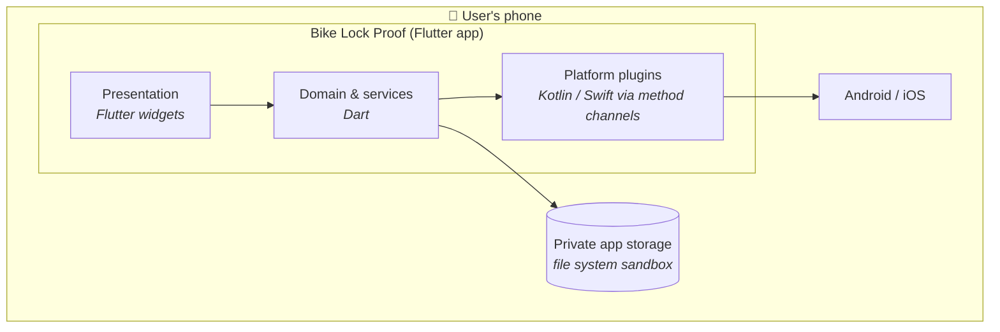
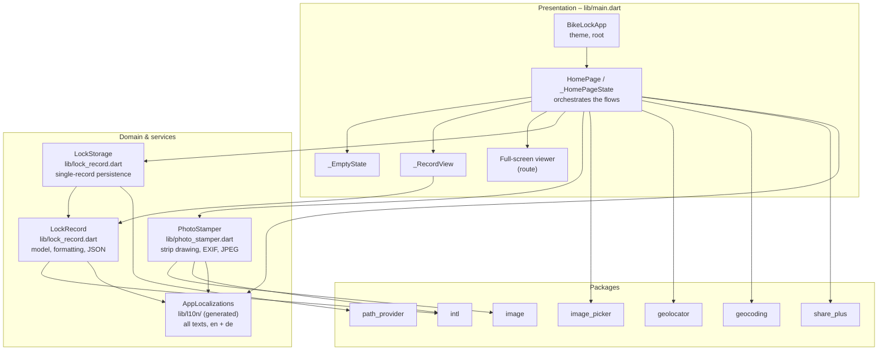
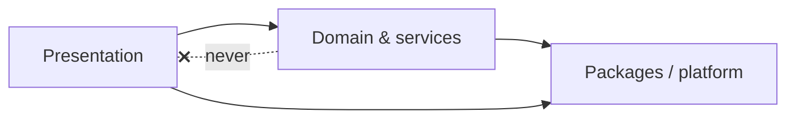
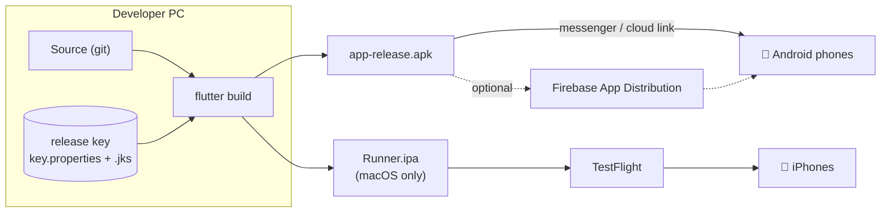
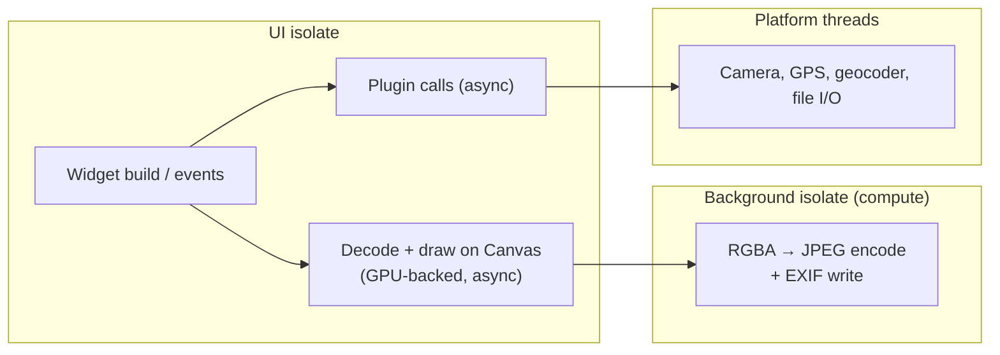

# 07 – System Architecture

[← UI and UX Specification](06-ui-ux-specification.md) · [Index](README.md) · [Next: Data Model and Storage →](08-data-model-and-storage.md)

The architecture is described with the [C4 model](https://c4model.com/)
levels 1–3, plus a deployment view.

## 7.1 System context (C4 level 1)

There is **no backend**. The only network traffic is the OS geocoder call
(FR-04) and whatever the user does in the share target.

## 7.2 Containers (C4 level 2)

## 7.3 Components (C4 level 3)

### Component responsibilities

| Component | Responsibility | Must not |
| --- | --- | --- |
| `BikeLockApp` | `MaterialApp`, light/dark theme | contain logic |
| `_HomePageState` | UI state (`_record`, `_loading`, `_busyMessage`); orchestrates capture → locate → stamp → store; sharing | do file I/O or image processing itself |
| `LockRecord` | Immutable value object; derived display strings; JSON (de)serialisation | access files or plugins |
| `LockStorage` | Read/write the one record; enforce FR-08 | know about widgets |
| `PhotoStamper` | Pure function: bytes + metadata → stamped JPEG bytes | store files |

## 7.4 Layering rules

- Domain code never imports Flutter widgets for UI purposes
  (`PhotoStamper` uses `dart:ui` and `TextPainter` only for off-screen
  drawing).
- Platform calls that are pure UI flow (camera, permission, share) are
  orchestrated by the presentation layer to keep the code small; extracting
  them into services is planned when a second screen appears (see ADR-05).

## 7.5 Technology stack

| Concern | Choice | Version (min) | Why |
| --- | --- | --- | --- |
| Framework | Flutter (stable) | 3.47 | single code base (C-1) |
| Language | Dart | 3.13 | null safety, records, null-aware elements |
| Camera | `image_picker` | 1.2 | system camera, no camera permission on Android, no gallery write (ADR-02) |
| Location | `geolocator` | 14.1 | permission handling + accuracy + timeouts |
| Address | `geocoding` | 5.0 | uses OS geocoder, no API key (ADR-06) |
| Storage path | `path_provider` | 2.1 | private documents directory |
| Sharing | `share_plus` | 13.3 | system share sheet, files + text |
| JPEG / EXIF | `image` | 4.10 | pure Dart encoder with EXIF write support (ADR-03) |
| Dates | `intl` | 0.20 | `DateFormat` |
| Translations | `flutter_localizations` + `gen-l10n` | SDK | official tooling, ARB files, type-safe generated API (NFR-61) |
| State | `StatefulWidget` | – | one screen, no library needed (ADR-05) |

## 7.6 Deployment view

Details in [13 – Release and Distribution](13-release-and-distribution.md).

## 7.7 Threading model

JPEG encoding of a 2560 px image takes about 1 s of CPU and therefore runs
in a background isolate (NFR-11).
