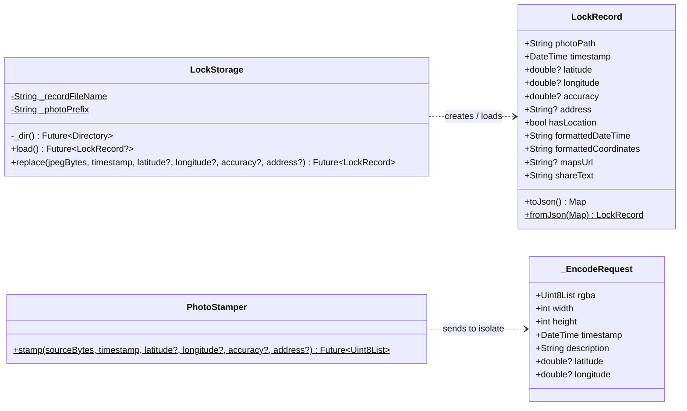
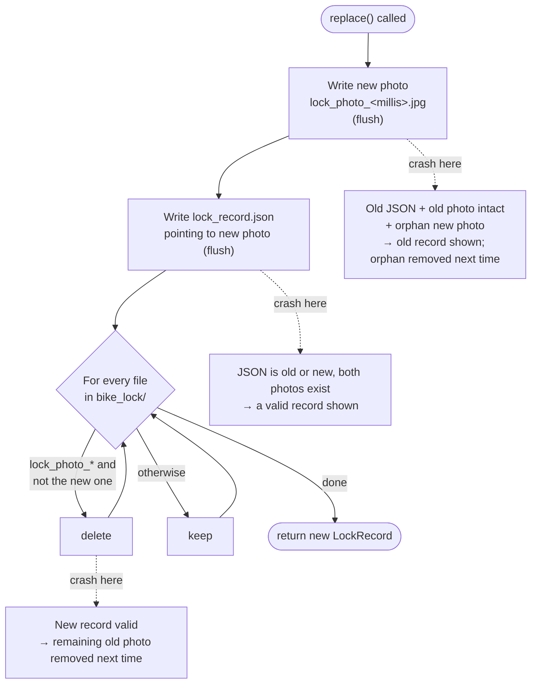
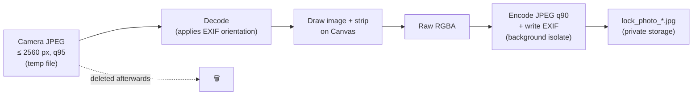

# 08 – Data Model and Storage

[← System Architecture](07-system-architecture.md) · [Index](README.md) · [Next: Dynamic Behaviour →](09-dynamic-behaviour.md)

## 8.1 Domain model



### Invariants

| ID | Invariant |
| --- | --- |
| INV-1 | `latitude` and `longitude` are either both set or both `null`. |
| INV-2 | `accuracy` is only set when the location is set. |
| INV-3 | `photoPath` points to an existing file inside the storage folder, otherwise the record is treated as absent. |
| INV-4 | After `replace()` returns, the folder contains exactly one `lock_photo_*.jpg`. |
| INV-5 | `timestamp` is local time, second precision is displayed; the stored value keeps full precision. |

## 8.2 File layout

```
<app documents directory>/
└── bike_lock/
    ├── lock_record.json          metadata of the current photo
    └── lock_photo_<epochMillis>.jpg   the one stamped photo
```

| Platform | Physical location |
| --- | --- |
| Android | `/data/user/0/com.bikelock.bike_lock_doc/app_flutter/bike_lock/` |
| iOS | `<app sandbox>/Documents/bike_lock/` |

The photo name contains the capture time in milliseconds so that every
photo has a **unique path**. This prevents Flutter's image cache from
showing the previous image after a replacement.

## 8.3 Metadata file – `lock_record.json`

### Example

```json
{
  "photoPath": "/data/user/0/com.bikelock.bike_lock_doc/app_flutter/bike_lock/lock_photo_1760113805000.jpg",
  "timestamp": "2026-10-10T18:30:05.123",
  "latitude": 52.520008,
  "longitude": 13.404954,
  "accuracy": 4.2,
  "address": "Main St 1, 10115 Berlin"
}
```

### JSON Schema

```json
{
  "$schema": "https://json-schema.org/draft/2020-12/schema",
  "title": "LockRecord",
  "type": "object",
  "required": ["photoPath", "timestamp"],
  "properties": {
    "photoPath": { "type": "string", "minLength": 1 },
    "timestamp": { "type": "string", "description": "ISO 8601 local date-time" },
    "latitude":  { "type": ["number", "null"], "minimum": -90,  "maximum": 90 },
    "longitude": { "type": ["number", "null"], "minimum": -180, "maximum": 180 },
    "accuracy":  { "type": ["number", "null"], "minimum": 0, "description": "metres" },
    "address":   { "type": ["string", "null"] }
  },
  "additionalProperties": false
}
```

Unknown fields are ignored when reading, so later versions may add fields
without breaking older ones.

## 8.4 Replacement algorithm

The replacement must satisfy FR-08 (exactly one photo) and NFR-05 (never
end up with no photo after a crash).



| Crash point | State on next start | Shown |
| --- | --- | --- |
| during / after writing the photo | old JSON, old + new photo | old record ✔ |
| during writing the JSON | JSON may be truncated → parse error | empty state (NFR-06) – see risk R-04 |
| after writing the JSON | new JSON, old + new photo | new record ✔ |
| during deletion | new JSON, maybe old photo | new record ✔ |

## 8.5 EXIF mapping

| EXIF IFD | Tag | Source | Format |
| --- | --- | --- | --- |
| IFD0 | `DateTime` (0x0132) | `timestamp` | `yyyy:MM:dd HH:mm:ss` |
| IFD0 | `ImageDescription` (0x010E) | strip lines joined with ` \| ` | ASCII |
| Exif | `DateTimeOriginal` (0x9003) | `timestamp` | `yyyy:MM:dd HH:mm:ss` |
| GPS | `GPSLatitudeRef` / `GPSLatitude` | `latitude` | `N`/`S`, degrees as rationals |
| GPS | `GPSLongitudeRef` / `GPSLongitude` | `longitude` | `E`/`W`, degrees as rationals |

Original camera EXIF (make, model, exposure) is **not** carried over; the
pixels are re-encoded after stamping.

## 8.6 Image pipeline



## 8.7 Data retention

| Data | Kept | Deleted when |
| --- | --- | --- |
| Current photo + JSON | until replaced | next successful photo; app uninstall |
| Previous photo | no | immediately after new one is saved |
| Camera temp file | no | right after processing |
| Location history | never stored | – |
