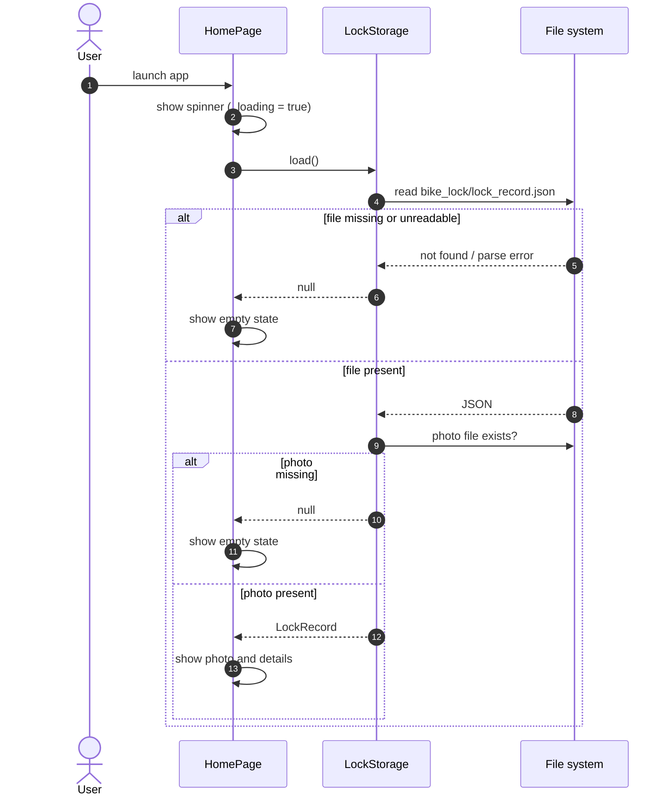
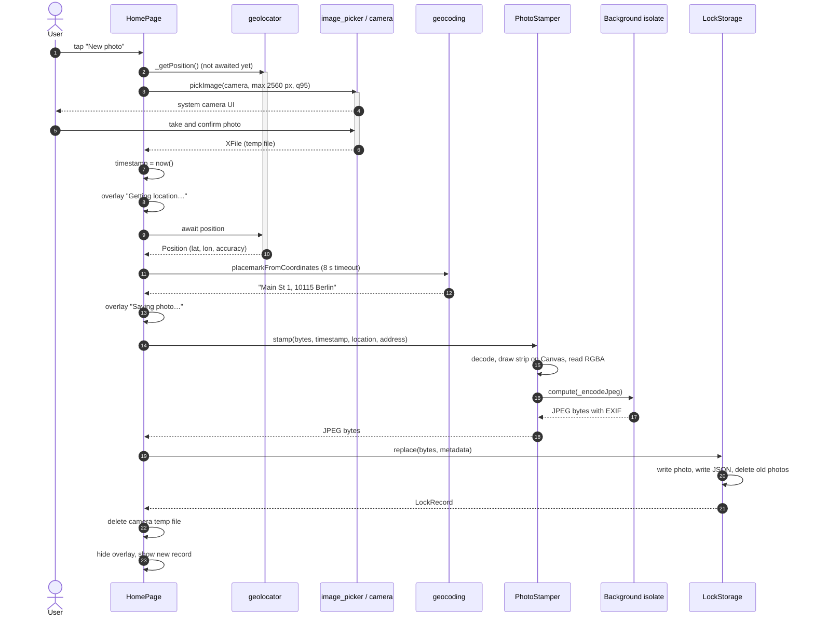
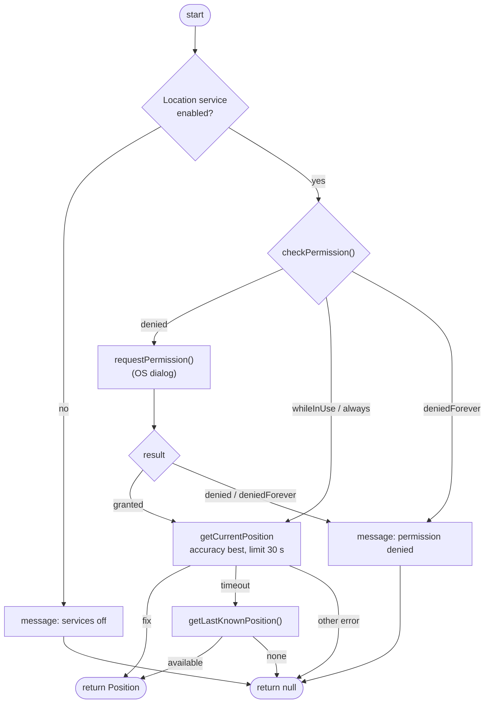
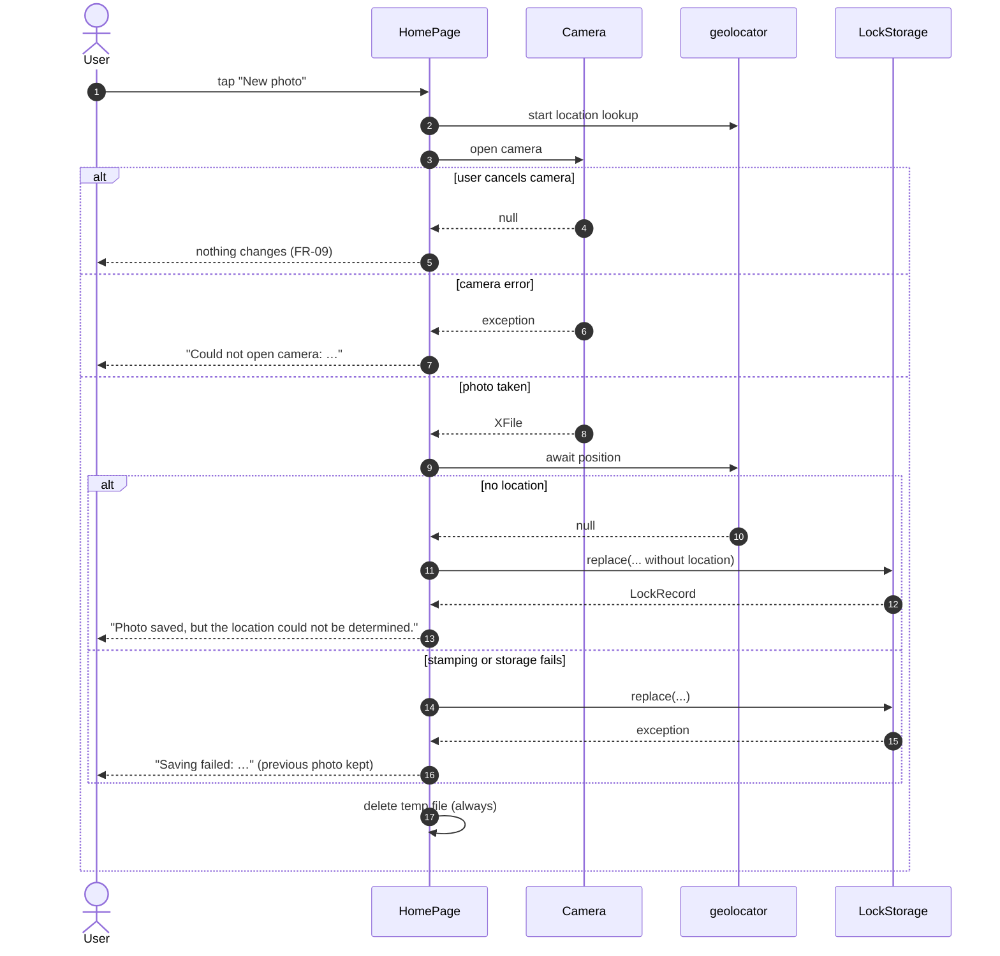
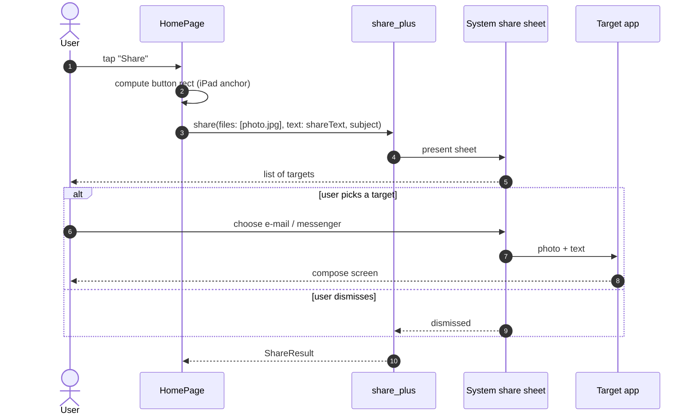
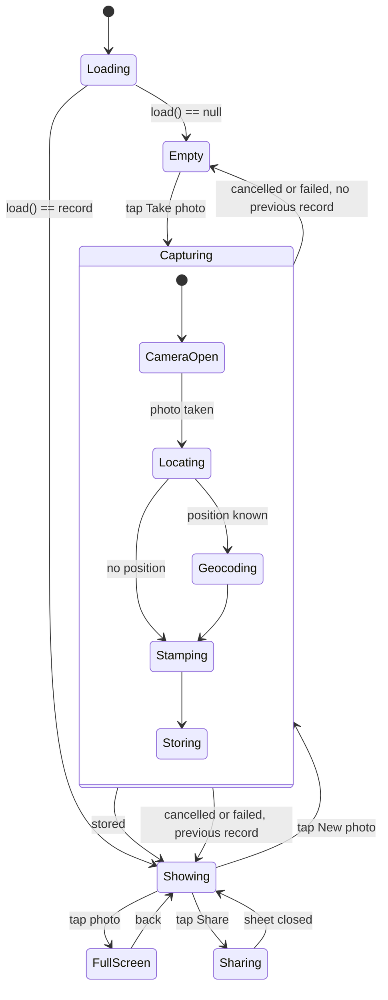

# 09 – Dynamic Behaviour

[← Data Model and Storage](08-data-model-and-storage.md) · [Index](README.md) · [Next: Privacy, Permissions and Security →](10-privacy-permissions-security.md)

## 9.1 App start (UC-02)

## 9.2 Document locked bike – main flow (UC-01)

## 9.3 Location acquisition (`_getPosition`)

## 9.4 Alternative flows of UC-01

## 9.5 Share (UC-04)

## 9.6 Home screen state machine

## 9.7 Timing budget (UC-01, typical)

```mermaid
gantt
    title Time from tap to saved photo (typical, good GPS)
    dateFormat  ss
    axisFormat  %S s
    section Parallel
    Location lookup          :loc, 00, 4s
    section User
    Camera open and shoot    :cam, 00, 5s
    section App
    Geocoding                :geo, after cam, 1s
    Stamping and encoding    :enc, after geo, 2s
    Storing and cleanup      :sto, after enc, 1s
```

Because location runs in parallel with the camera, the user usually doesn't
wait for GPS at all (G-1, NFR-10).
