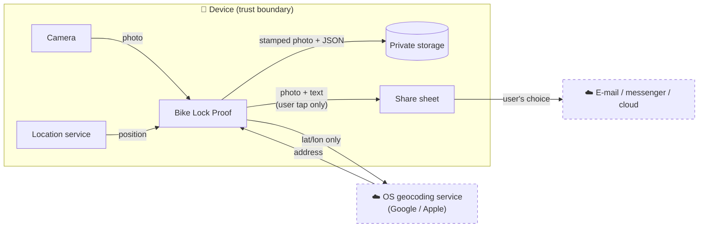
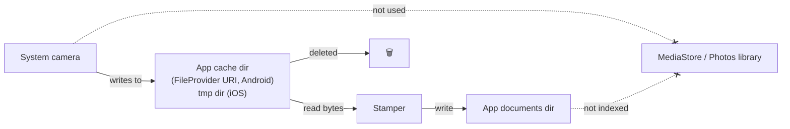

# 10 – Privacy, Permissions and Security

[← Dynamic Behaviour](09-dynamic-behaviour.md) · [Index](README.md) · [Next: Error Handling →](11-error-handling.md)

## 10.1 Privacy principles

| Principle | How the app follows it |
| --- | --- |
| **Data minimisation** | Only one photo and one location are kept; no history. |
| **Local first** | All data stays on the device; no server, no account. |
| **Purpose limitation** | Location is used only to stamp and share the photo. |
| **User control** | Data leaves the device only when the user taps *Share*. |
| **Transparency** | Permission texts explain why each permission is needed. |
| **Storage limitation** | Previous photos are deleted immediately; uninstall removes everything. |

## 10.2 Data flow

| Data | Leaves device? | To whom | Legal basis (GDPR) |
| --- | --- | --- | --- |
| Photo | only via *Share* | recipient chosen by user | user's own action |
| Coordinates | yes, for address lookup | OS vendor geocoder | legitimate interest / user's OS terms |
| Coordinates, time, address | only via *Share* | recipient chosen by user | user's own action |
| Usage / analytics | **never** | – | – |

The app's developer receives **no data at all**. A privacy policy is only
required if the app is published in an app store (out of scope for 1.0).

## 10.3 Permissions

| Platform | Permission | Type | When requested | Required for | If denied |
| --- | --- | --- | --- | --- | --- |
| Android | `ACCESS_FINE_LOCATION` | runtime | first photo | precise GPS | photo saved without location |
| Android | `ACCESS_COARSE_LOCATION` | runtime | with fine | Android 12+ approximate option | lower accuracy shown as ± m |
| Android | `INTERNET` | install-time | – | geocoder | no address |
| Android | Camera | **none** | – | system camera app is used via intent | – |
| Android | Storage / media | **none** | – | private storage needs none | – |
| iOS | `NSCameraUsageDescription` | runtime | first photo | camera | photo can't be taken |
| iOS | `NSLocationWhenInUseUsageDescription` | runtime | first photo | GPS | photo saved without location |
| iOS | `NSPhotoLibraryUsageDescription` | declared | never shown | required by `image_picker` setup | – |

**Explicitly not requested**: background location, contacts, storage /
media library write, network state, notifications.

### Permission texts (iOS)

| Key | Text |
| --- | --- |
| Camera | *The camera is used to photograph your locked bike.* |
| Location | *Your location is saved with the photo to document where your bike is locked.* |
| Photo library | *Photos are kept inside the app and are not added to your library.* |

## 10.4 Why the photo never reaches the gallery

- `image_picker` passes a private output URI to the camera; the camera app
  writes there and not into `DCIM`.
- The app's internal storage isn't scanned by the Android media scanner and
  isn't part of the iOS Photos library.
- *Known exception*: a few Android camera apps (vendor-specific) also save a
  copy to the gallery on their own. This is outside the app's control; see
  risk R-02.

## 10.5 Threat model (STRIDE, lightweight)

| Threat | Example | Mitigation | Residual risk |
| --- | --- | --- | --- |
| **S**poofing | Someone shares a fake "proof" | Out of scope; app doesn't claim legal proof | accepted |
| **T**ampering | Photo edited after export | Info burned into pixels and EXIF; edits are visible to experts. Signing is future work (R-07) | medium, accepted |
| **T**ampering | Wrong phone clock | Uses system time like every camera | accepted |
| **R**epudiation | – | not applicable (single user) | – |
| **I**nformation disclosure | Other apps read the photo | Sandbox storage; no world-readable files | low |
| **I**nformation disclosure | Shared photo reveals home location | User decides what to share; EXIF GPS stated in docs | low |
| **I**nformation disclosure | Device backup | iOS/Android backups include app data, encrypted by the OS | low |
| **D**enial of service | – | not applicable | – |
| **E**levation of privilege | – | no exported components besides the launcher activity | low |

## 10.6 Secure development

- Release signing keys are **never committed** (`key.properties`, `*.jks` in
  `android/.gitignore`) – NFR-51.
- Dependencies pinned in `pubspec.lock`; `flutter pub outdated` reviewed
  before each release.
- Release builds use Flutter's defaults: Dart compiled ahead-of-time, Android
  code shrunk with R8. Dart symbol obfuscation (`--obfuscate`) is not needed
  as the app holds no secrets.
