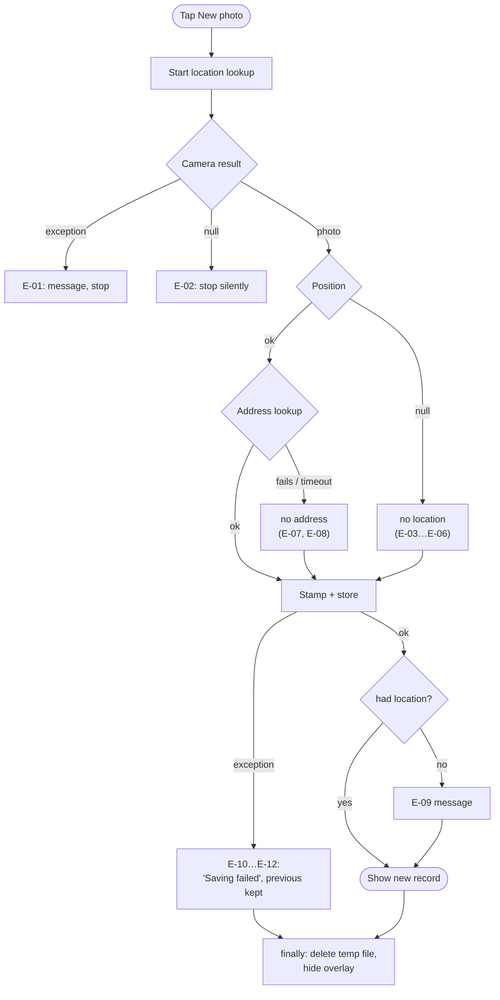

# 11 – Error Handling

[← Privacy, Permissions and Security](10-privacy-permissions-security.md) · [Index](README.md) · [Next: Test Plan →](12-test-plan.md)

## 11.1 Principles

1. **Never lose the existing proof.** No error may delete the previous photo
   (NFR-05).
2. **Degrade, don't fail.** Missing location or address reduces the
   information on the photo but never prevents saving (FR-13).
3. **Tell the user briefly.** One snack bar sentence; no technical dialogs
   (NFR-23).
4. **No unhandled exceptions.** Every plugin call is wrapped (NFR-07).
5. **Clean up always.** Temporary files are deleted in a `finally` block
   (FR-15).

## 11.2 Error catalogue

| ID | Error | Source | Detection | Behaviour | Message | Severity |
| --- | --- | --- | --- | --- | --- | --- |
| E-01 | Camera unavailable / crashes | `image_picker` | exception | abort, nothing changed | `Could not open camera: …` | high |
| E-02 | User cancels camera | `image_picker` | `null` result | abort silently | – | info |
| E-03 | Location service off | `geolocator` | `isLocationServiceEnabled() == false` | continue without location | `Location services are turned off.` | medium |
| E-04 | Permission denied | `geolocator` | `denied` / `deniedForever` | continue without location | `Location permission denied.` | medium |
| E-05 | No GPS fix within 30 s | `geolocator` | `TimeoutException` | use last known position, else none | – (E-09 if none) | low |
| E-06 | Other location error | `geolocator` | any exception | continue without location | – (E-09) | low |
| E-07 | Geocoder offline / no result | `geocoding` | exception, empty list | continue without address | – | low |
| E-08 | Geocoder too slow | `geocoding` | 8 s timeout | continue without address | – | low |
| E-09 | Saved without location | app | `position == null` | photo saved | `Photo saved, but the location could not be determined.` | medium |
| E-10 | Image decode / draw fails | `dart:ui` | exception | abort, previous photo kept | `Saving failed: …` | high |
| E-11 | JPEG encode fails | `image` (isolate) | exception | abort, previous photo kept | `Saving failed: …` | high |
| E-12 | Disk full / write error | `dart:io` | `FileSystemException` | abort, previous photo kept | `Saving failed: …` | high |
| E-13 | Metadata corrupt on start | `dart:convert` | parse exception | show empty state | – | medium |
| E-14 | Photo file missing on start | `dart:io` | `exists() == false` | show empty state | – | medium |
| E-15 | Temp file can't be deleted | `dart:io` | exception | ignore (OS cleans cache) | – | info |
| E-16 | Share sheet error | `share_plus` | exception | nothing changes | – | low |
| E-17 | Widget disposed during async work | Flutter | `mounted == false` | skip `setState` / messages | – | info |

## 11.3 Decision flow during capture

## 11.4 Logging

Release 1.0 has **no logging framework and no remote crash reporting**
(NFR-02). During development, errors appear in `flutter logs` /
`adb logcat`. Error texts in snack bars include the exception message for
easier support by the developer.
