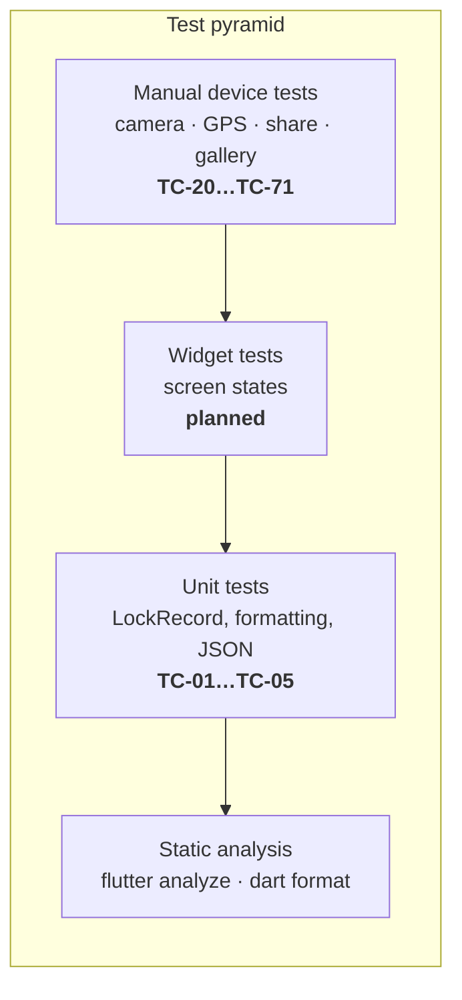
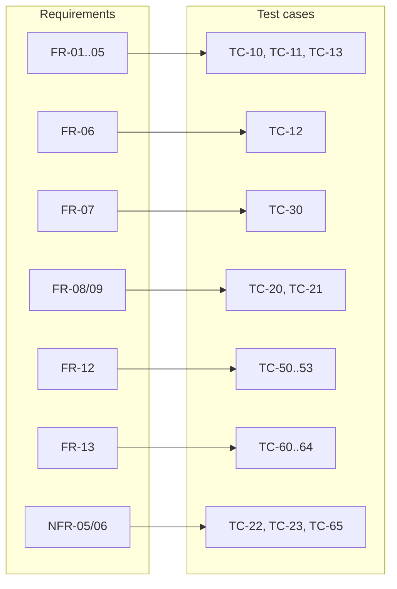

# 12 – Test Plan

[← Error Handling](11-error-handling.md) · [Index](README.md) · [Next: Release and Distribution →](13-release-and-distribution.md)

## 12.1 Strategy

| Level | Tool | Scope | When |
| --- | --- | --- | --- |
| Static analysis | `flutter analyze`, `dart format` | all Dart code | every change |
| Unit | `flutter test` | `LockRecord` model and formatting | every change |
| Widget | `flutter test` + fakes | home screen states | when screens grow (future) |
| Manual / device | real Android and iOS phones | camera, GPS, files, share | before each release |

Camera, GPS and share sheets are platform UI and can't be automated
reliably in `flutter test`; they are covered by the manual test protocol
below.

## 12.2 Test environment

| Device | OS | Purpose |
| --- | --- | --- |
| Android mid-range (2022+) | Android 14+ | main device, performance (NFR-10) |
| Android older | Android 10–12 | compatibility, approximate location option |
| iPhone | current iOS | iOS flows (if Mac available) |
| iPad (optional) | current iPadOS | share popover anchor (NFR-32) |

## 12.3 Test cases

### Unit tests (automated, `test/widget_test.dart`)

| ID | Title | Steps / expectation | Req. |
| --- | --- | --- | --- |
| TC-01 | JSON round trip | `fromJson(toJson(r))` equals `r` in all fields | FR-10 |
| TC-02 | Date formatting | `10.10.2026 18:30:05` for 2026-10-10 18:30:05 | NFR-60 |
| TC-03 | Maps link | share text contains `maps.google.com/?q=52.520008,13.404954` | FR-12 |
| TC-04 | No location | `hasLocation == false`, `mapsUrl == null`, text says `Unknown location` | FR-13 |
| TC-05 | Static analysis | `flutter analyze` → *No issues found* | NFR-40 |

### Capture and evidence (manual)

| ID | Title | Steps | Expected | Req. |
| --- | --- | --- | --- | --- |
| TC-10 | First photo | Fresh install → *Take photo* → allow location → shoot | Photo shown; strip with date, address, GPS; details card matches | FR-01…FR-05, FR-10 |
| TC-11 | Orientation | Shoot in portrait and in landscape | Both photos upright, strip at the bottom edge | FR-18 |
| TC-12 | EXIF | Share photo to PC, inspect with `exiftool` | `DateTimeOriginal`, `GPSLatitude/Longitude`, `ImageDescription` present and correct | FR-06 |
| TC-13 | Umlauts | Shoot at an address with ä/ö/ü/ß | Address rendered correctly on strip | FR-05 |
| TC-14 | Permission prompt timing | Fresh install, open app | No permission dialog until first photo | FR-17 |

### Storage (manual)

| ID | Title | Steps | Expected | Req. |
| --- | --- | --- | --- | --- |
| TC-20 | Replacement | Take photo A, then photo B; inspect `run-as … ls app_flutter/bike_lock` | Only B's JPEG and the JSON exist | FR-08 |
| TC-21 | Cancel keeps photo | With photo A, tap *New photo* → cancel | A still shown, files unchanged | FR-09 |
| TC-22 | Kill during save | Tap *New photo*, shoot, kill app during *Saving photo…* | On restart a valid photo (A or B) is shown | NFR-05 |
| TC-23 | Corrupt metadata | Overwrite JSON with garbage (`adb shell run-as`) | Empty state, no crash | NFR-06 |
| TC-24 | Temp file removed | After saving, check app cache dir | No leftover camera image | FR-15 |

### Privacy (manual)

| ID | Title | Steps | Expected | Req. |
| --- | --- | --- | --- | --- |
| TC-30 | Gallery clean | Count gallery images, take 3 photos, recount | Count unchanged | FR-07 |
| TC-31 | No hidden traffic | Airplane mode + Wi-Fi proxy log while taking photo | Only geocoder traffic | NFR-01 |
| TC-32 | No background location | Android settings → app → location | Only "while using the app" offered | NFR-03 |
| TC-33 | Uninstall | Uninstall, reinstall | Empty state | NFR-04 |

### Performance and usability (manual)

| ID | Title | Steps | Expected | Req. |
| --- | --- | --- | --- | --- |
| TC-40 | Task time | Stopwatch: app icon → photo saved | ≤ 15 s; ≤ 2 in-app taps | G-1, NFR-20 |
| TC-41 | Processing time | Stopwatch: shutter confirmed → overlay gone (GPS already fixed) | ≤ 3 s | NFR-10 |
| TC-42 | Start time | Warm start with photo | Photo visible ≤ 1.5 s | NFR-12 |
| TC-43 | File size | Check saved JPEG | ≤ 2560 px long side; typically ≤ 2 MB | NFR-13 |
| TC-44 | Dark mode | Switch system to dark | App follows; texts readable | NFR-22 |
| TC-45 | Large font | System font size max | Texts scale, no overflow errors | NFR-26 |
| TC-46 | Language | Set phone (or app) language to German, take and share a photo; then to French | German UI, strip, share text and address; French falls back to English | NFR-61, NFR-63 |

### Sharing (manual)

| ID | Title | Steps | Expected | Req. |
| --- | --- | --- | --- | --- |
| TC-50 | Share to e-mail | *Share* → mail app | Photo attached; subject `Bike lock <date>`; body with text and link | FR-12 |
| TC-51 | iPad popover | *Share* on iPad | Popover anchored at Share button | NFR-32 |
| TC-52 | Recipient view | Open received photo on PC and other phone | Correct orientation; strip readable | NFR-33, G-2 |
| TC-53 | Share disabled | Empty state | *Share* disabled | FR-12 |

### Error handling (manual)

| ID | Title | Steps | Expected | Req. |
| --- | --- | --- | --- | --- |
| TC-60 | Location off | Disable location, take photo | Message E-03, then E-09; strip `Location unavailable` | FR-13 |
| TC-61 | Permission denied | Deny dialog | Message E-04, E-09; photo saved | FR-13 |
| TC-62 | Denied forever | Deny permanently, take photo | No dialog; message E-04 | FR-17 |
| TC-63 | Offline | Airplane mode with GPS on | Photo with coordinates, no address | FR-04 |
| TC-64 | Indoor, no fix | Basement, no last known position | After ≤ 30 s: saved without location | FR-03 |
| TC-65 | Disk full | Fill storage, take photo | `Saving failed`, previous photo kept | NFR-05 |
| TC-66 | Rotate during processing | Rotate phone while overlay shown | No crash; result saved | NFR-07 |

### Build and distribution (manual)

| ID | Title | Steps | Expected | Req. |
| --- | --- | --- | --- | --- |
| TC-70 | One-command build | `flutter build apk --release` on clean checkout | APK produced | NFR-50 |
| TC-71 | Update keeps data | Install v1 + photo; install v2 APK (same key, higher build no.) | Photo still there | NFR-52 |

## 12.4 Traceability matrix

| Requirement | Test cases |
| --- | --- |
| FR-01 Camera | TC-10 |
| FR-02 Timestamp | TC-02, TC-10 |
| FR-03 GPS | TC-10, TC-64 |
| FR-04 Address | TC-10, TC-13, TC-63 |
| FR-05 Strip | TC-10, TC-13, TC-52 |
| FR-06 EXIF | TC-12 |
| FR-07 Private storage | TC-30 |
| FR-08 Exactly one | TC-20 |
| FR-09 Cancel | TC-21 |
| FR-10 Show | TC-01, TC-10 |
| FR-11 Zoom | TC-10 (visual) |
| FR-12 Share | TC-03, TC-50, TC-51, TC-53 |
| FR-13 Degradation | TC-04, TC-60, TC-61 |
| FR-14 Progress | TC-41 (visual) |
| FR-15 Temp file | TC-24 |
| FR-16 Empty state | TC-23, TC-33 |
| FR-17 Permission timing | TC-14, TC-62 |
| FR-18 Upright | TC-11 |
| NFR-01…04 Privacy | TC-30…TC-33 |
| NFR-05…07 Reliability | TC-22, TC-23, TC-65, TC-66 |
| NFR-10…13 Performance | TC-41…TC-43 |
| NFR-20…27 Usability | TC-40, TC-44, TC-45 |
| NFR-60…63 Localisation | TC-02, TC-46 |
| NFR-32, 33 Compatibility | TC-51, TC-52 |
| NFR-40 Analysis | TC-05 |
| NFR-50…52 Distribution | TC-70, TC-71 |

## 12.5 Exit criteria for release

- All automated tests green; `flutter analyze` clean.
- All manual **Must** test cases passed on at least one Android device.
- No open defect of severity *high*.
- Test protocol (date, device, tester, result per TC) stored with the
  release notes.
