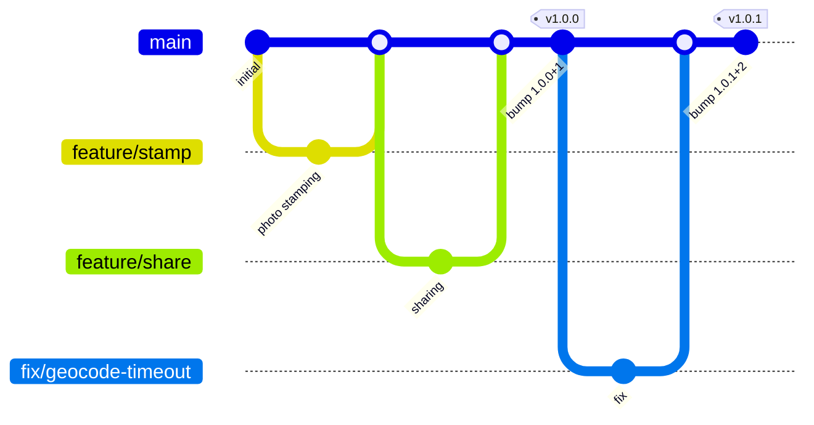
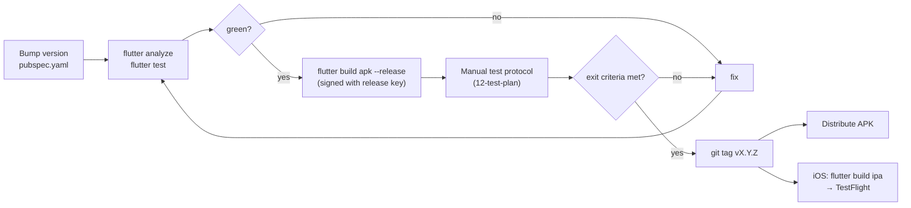
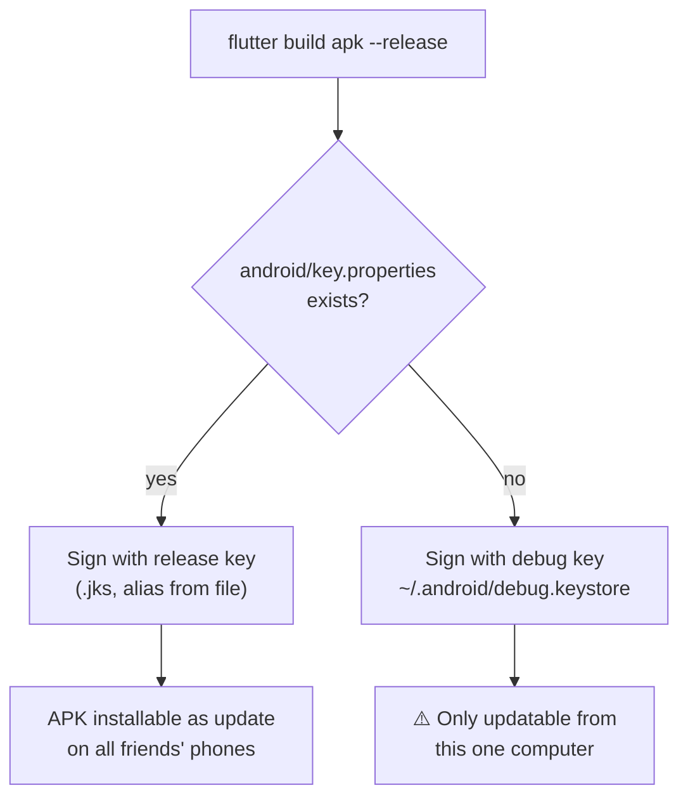
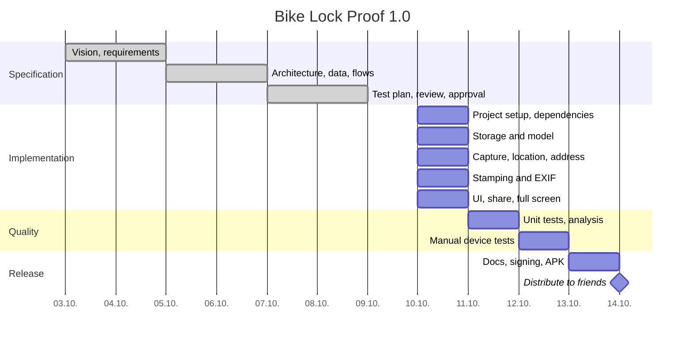

# 13 – Release and Distribution

[← Test Plan](12-test-plan.md) · [Index](README.md) · [Next: Architecture Decision Records →](14-architecture-decisions.md)

Step-by-step commands are in the [README](../../README.md#building); this
document defines the process.

## 13.1 Versioning

`pubspec.yaml` → `version: MAJOR.MINOR.PATCH+BUILD`

| Part | Increase when | Example |
| --- | --- | --- |
| MAJOR | stored data format changes incompatibly | `2.0.0` |
| MINOR | new feature | `1.1.0` |
| PATCH | bug fix | `1.0.1` |
| BUILD | **every** distributed build (Android `versionCode`) | `+7` |

Android refuses updates with an equal or lower `versionCode`; the build
number therefore only ever increases.

## 13.2 Branching and release flow

- `main` is always releasable.
- Work happens on short-lived `feature/*` and `fix/*` branches.
- Releases are tagged `vMAJOR.MINOR.PATCH`.

## 13.3 Release pipeline

## 13.4 Signing

- The release keystore and `key.properties` are kept **outside git** and
  backed up (password manager + offline copy).
- Losing the key means friends must uninstall (losing their photo) before
  installing a newer version → risk R-05.

## 13.5 Distribution channels

| Channel | Platform | Cost | Effort | Auto-update notice | Chosen for 1.0 |
| --- | --- | --- | --- | --- | --- |
| APK via messenger / cloud link | Android | free | low | no | ✅ |
| Firebase App Distribution | Android, iOS | free | medium | yes | optional |
| Google Play internal testing | Android | 25 USD once | medium | yes (Play Store) | later |
| TestFlight | iOS | 99 USD / year | medium | yes | if iOS needed |
| Public app stores | both | as above | high | yes | ❌ out of scope |

## 13.6 Project plan (implementation)

## 13.7 Definition of Done

A change is done when:

- [ ] It implements the referenced requirement IDs.
- [ ] `flutter analyze` reports no issues; code is formatted.
- [ ] Unit tests added/updated where logic changed; all tests pass.
- [ ] Public classes/methods have doc comments.
- [ ] README / spec updated if behaviour or build steps changed.
- [ ] Tested on a real device for camera/GPS/share changes.
