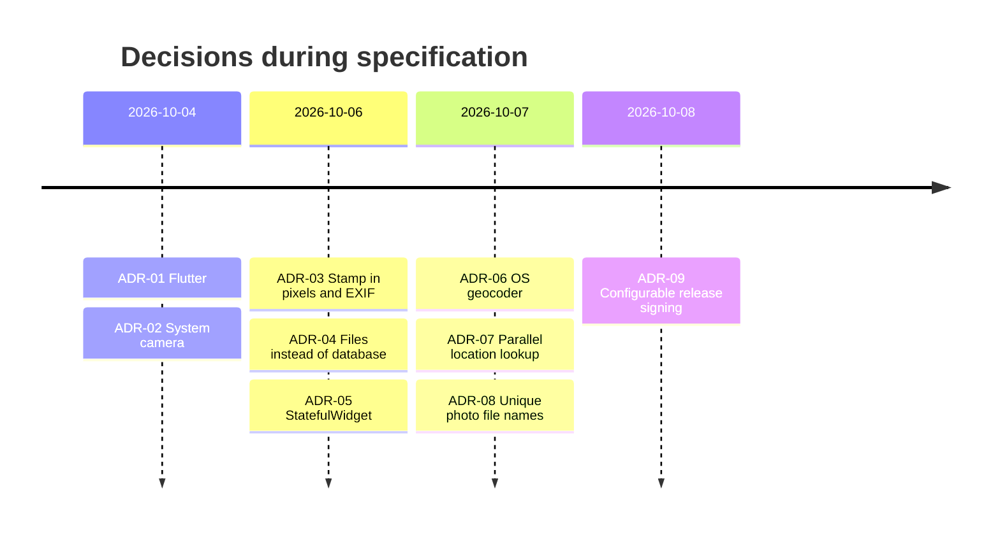

# 14 – Architecture Decision Records

[← Release and Distribution](13-release-and-distribution.md) · [Index](README.md) · [Next: Risks and Open Issues →](15-risks-and-open-issues.md)

Format: [MADR](https://adr.github.io/madr/) (short form). All records have
status **Accepted** unless noted.

---

## ADR-01 – Flutter as cross-platform framework

- **Context**: Android and iOS needed (C-1); one developer.
- **Options**: native Kotlin + Swift; React Native; Flutter; PWA.
- **Decision**: **Flutter**.
- **Reasons**: one code base, mature camera/location/share plugins,
  developer familiarity, good performance for image drawing.
- **Consequences**: iOS builds still need a Mac; larger app than native
  (universal release APK ≈ 48 MB).

## ADR-02 – System camera via `image_picker` instead of in-app camera

- **Options**: `camera` package (custom preview UI); `image_picker`
  (system camera app).
- **Decision**: **`image_picker`**.
- **Reasons**: no camera permission on Android; familiar camera UI with
  zoom/flash; far less code; output goes to a private temp file, not the
  gallery (FR-07).
- **Consequences**: no custom overlay in the viewfinder; some vendor camera
  apps may save an extra copy themselves (R-02).

## ADR-03 – Information stamped into pixels **and** EXIF

- **Options**: EXIF only; visible stamp only; both; separate PDF report.
- **Decision**: **both**.
- **Reasons**: visible stamp works for any recipient, survives messengers
  that strip EXIF (WhatsApp, Signal); EXIF gives machine-readable precise
  data where it survives.
- **Consequences**: image must be re-encoded (original EXIF lost); text
  drawing via Flutter `Canvas` for proper Unicode; encoding in background
  isolate with the pure-Dart `image` package, which supports writing EXIF.

## ADR-04 – Plain files instead of a database

- **Options**: `shared_preferences`; SQLite; Hive/Isar; JSON file.
- **Decision**: **one JSON file + one JPEG** in the documents directory.
- **Reasons**: one record only; no extra dependency; trivially inspectable;
  ordering of writes gives crash safety (see
  [08 §8.4](08-data-model-and-storage.md#84-replacement-algorithm)).
- **Consequences**: no transactions; truncated JSON on crash leads to empty
  state (R-04, mitigable with write-to-temp-and-rename).

## ADR-05 – `StatefulWidget` instead of a state-management library

- **Options**: Provider, Riverpod, Bloc, plain `setState`.
- **Decision**: **plain `setState`** in one `StatefulWidget`.
- **Reasons**: one screen, three state variables; libraries would add more
  code than they save.
- **Consequences**: orchestration lives in the widget state; revisit when a
  second screen with shared state appears.

## ADR-06 – OS geocoder (`geocoding`) instead of a web API

- **Options**: Google Geocoding API; OpenStreetMap Nominatim; OS geocoder.
- **Decision**: **OS geocoder** via `geocoding`.
- **Reasons**: no API key, no cost, no own server, no terms-of-use issues
  (Nominatim forbids heavy app use without own instance).
- **Consequences**: needs internet; result quality depends on the OS;
  optional by design (FR-04).

## ADR-07 – Location lookup in parallel with the camera

- **Options**: get location before opening camera; after the photo; in
  parallel.
- **Decision**: **parallel** – start the future before `pickImage`, await it
  after.
- **Reasons**: GPS fix takes 2–10 s; the user spends that time framing the
  photo, so perceived waiting is near zero (G-1).
- **Consequences**: the permission dialog may appear just before the camera
  opens; position reflects the moment *before* the photo (same place).

## ADR-08 – Unique file name per photo

- **Options**: fixed `lock_photo.jpg`; unique `lock_photo_<millis>.jpg`.
- **Decision**: **unique name**.
- **Reasons**: Flutter's `Image.file` caches by path – a fixed name would
  show the old photo; also enables write-new-then-delete-old (NFR-05).
- **Consequences**: deletion step must remove all other `lock_photo_*`.

## ADR-09 – Release signing via optional `key.properties`

- **Options**: always debug key; hard-coded keystore in repo; optional
  properties file.
- **Decision**: **optional `android/key.properties`**, falling back to the
  debug key.
- **Reasons**: no secrets in git (NFR-51); builds still work for anyone
  cloning the repo; stable key for updates (NFR-52).
- **Consequences**: maintainer must back up the keystore (R-05).
