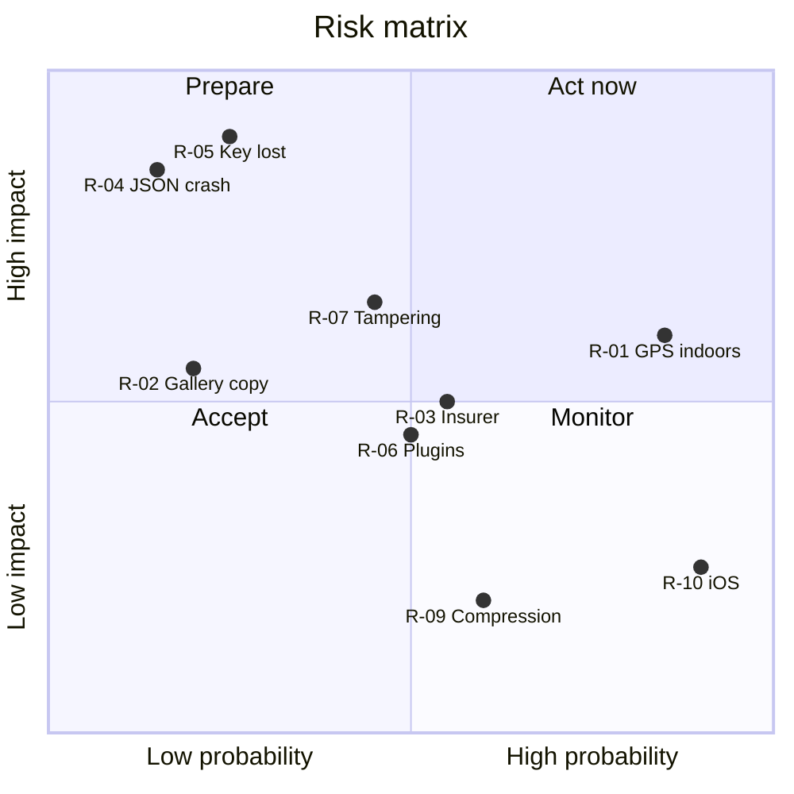
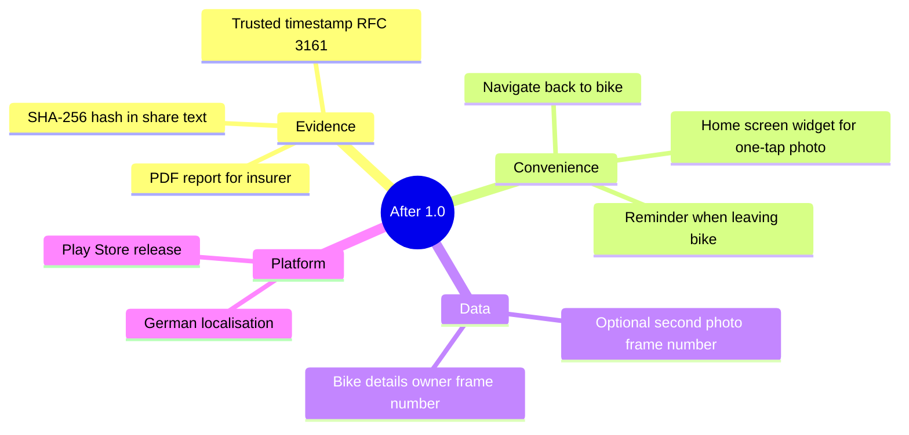

# 15 – Risks and Open Issues

[← Architecture Decision Records](14-architecture-decisions.md) · [Index](README.md) · [Next: Glossary →](16-glossary.md)

## 15.1 Risk register

Probability (P) and impact (I): 1 = low … 3 = high. Score = P × I.

| ID | Risk | P | I | Score | Mitigation | Owner |
| --- | --- | --- | --- | --- | --- | --- |
| R-01 | GPS unavailable in garages / underground parking | 3 | 2 | 6 | parallel lookup, 30 s limit, last known position, save without location (FR-13) | dev |
| R-02 | Vendor camera app also saves a copy to the gallery | 1 | 2 | 2 | document; test on target devices (TC-30) | QA |
| R-03 | Insurer doesn't accept the photo as proof | 2 | 2 | 4 | visible stamp + EXIF; clearly not marketed as legal proof | product |
| R-04 | Crash while writing JSON leaves no valid record | 1 | 3 | 3 | write order; future: write to temp file + atomic rename | dev |
| R-05 | Release key lost → updates impossible | 1 | 3 | 3 | backup of keystore and passwords | maintainer |
| R-06 | Plugin breaking changes (major versions) | 2 | 2 | 4 | `pubspec.lock`; review `flutter pub outdated` per release | dev |
| R-07 | Photo could be edited after export | 2 | 2 | 4 | future: hash + signature / trusted timestamp | product |
| R-08 | Wrong system clock on the phone | 1 | 2 | 2 | accepted; same as any camera | – |
| R-09 | Messenger compresses image, strip unreadable | 2 | 1 | 2 | font size relative to image (3.5 %); send as file | dev |
| R-10 | iOS distribution needs Mac + paid account | 3 | 1 | 3 | Android first; TestFlight when needed | maintainer |

## 15.2 Assumptions

| ID | Assumption | If wrong |
| --- | --- | --- |
| A-1 | Users have location services enabled most of the time | more photos without location; still useful |
| A-2 | Phone clock is set automatically (network time) | timestamps wrong |
| A-3 | One bike per user | need multiple records → new major version |
| A-4 | Recipients accept JPEG + text via e-mail | add PDF export |
| A-5 | OS geocoder is available on target phones (Google Play services / Apple) | no addresses on de-Googled Android; coordinates still work |

## 15.3 Open issues

| ID | Issue | Decision needed by | Status |
| --- | --- | --- | --- |
| O-1 | German UI translation? | after 1.0 feedback | open |
| O-2 | Show "photo is X hours old" hint? | after 1.0 feedback | open |
| O-3 | Atomic JSON write (temp + rename) for R-04 | 1.1 | planned |
| O-4 | Extract camera/location/share into services for widget tests | when 2nd screen appears | deferred |

## 15.4 Future work (backlog)

