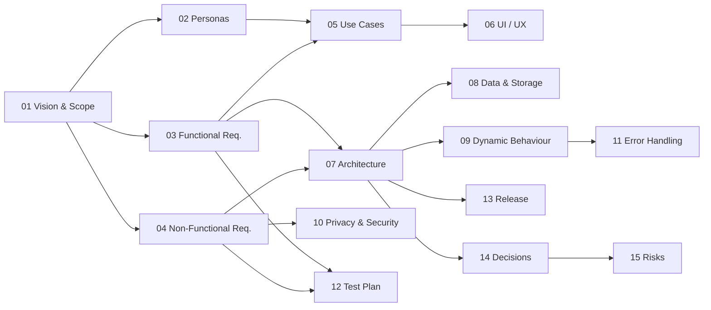

# Bike Lock Proof – Software Specification

| | |
| --- | --- |
| **Product** | Bike Lock Proof (package `bike_lock_doc`) |
| **Document set** | Software Requirements & Design Specification |
| **Version** | 1.0 |
| **Status** | Approved for implementation |
| **Target release** | 1.0.0 |
| **Platforms** | Android, iOS (Flutter) |

This folder holds the specification written before implementation. It
describes *what* the app must do, *why*, and *how* it is designed. The
documents are numbered in reading order; each one can also be read alone.

## Documents

| # | Document | Content | Audience |
| --- | --- | --- | --- |
| 01 | [Vision and Scope](01-vision-and-scope.md) | Problem, goals, scope, out of scope, success criteria | everyone |
| 02 | [Stakeholders and Personas](02-stakeholders-and-personas.md) | Who uses the app, user journeys | product, UX |
| 03 | [Functional Requirements](03-functional-requirements.md) | User stories, numbered requirements, acceptance criteria | product, dev, QA |
| 04 | [Non-Functional Requirements](04-non-functional-requirements.md) | Privacy, performance, reliability, usability, compatibility | dev, QA |
| 05 | [Use Cases](05-use-cases.md) | Detailed use cases with main and alternative flows | dev, QA |
| 06 | [UI and UX Specification](06-ui-ux-specification.md) | Screens, wireframes, navigation, states, texts | UX, dev |
| 07 | [System Architecture](07-system-architecture.md) | Context, components, layers, technology choices | dev |
| 08 | [Data Model and Storage](08-data-model-and-storage.md) | Entities, file layout, JSON schema, EXIF mapping | dev |
| 09 | [Dynamic Behaviour](09-dynamic-behaviour.md) | Sequence and state diagrams for every flow | dev, QA |
| 10 | [Privacy, Permissions and Security](10-privacy-permissions-security.md) | Permissions, GDPR, threat model | dev, legal |
| 11 | [Error Handling](11-error-handling.md) | Failure catalogue, degradation rules, user messages | dev, QA |
| 12 | [Test Plan](12-test-plan.md) | Test strategy, test cases, traceability matrix | QA |
| 13 | [Release and Distribution](13-release-and-distribution.md) | Build pipeline, signing, versioning, project plan | dev, release |
| 14 | [Architecture Decision Records](14-architecture-decisions.md) | Key decisions with alternatives and reasons | dev |
| 15 | [Risks and Open Issues](15-risks-and-open-issues.md) | Risk register, assumptions, future work | everyone |
| 16 | [Glossary](16-glossary.md) | Terms and abbreviations | everyone |

## Map of the specification

## Conventions

- **Requirement IDs**: `FR-xx` functional, `NFR-xx` non-functional,
  `UC-xx` use case, `TC-xx` test case, `ADR-xx` decision, `R-xx` risk,
  `E-xx` error. IDs are stable and never reused.
- **Priority (MoSCoW)**: **M**ust, **S**hould, **C**ould, **W**on't (this
  release).
- **Normative words**: *must* = mandatory, *should* = recommended,
  *may* = optional.
- Diagrams use [Mermaid](https://mermaid.js.org/); GitHub, GitLab and most
  IDEs render them directly.

## Change history

| Version | Date | Change |
| --- | --- | --- |
| 0.1 | 2026-10-03 | First draft: vision, requirements |
| 0.5 | 2026-10-06 | Architecture, data model, dynamic behaviour |
| 0.9 | 2026-10-08 | Test plan, release, review feedback |
| 1.0 | 2026-10-09 | Approved for implementation |
